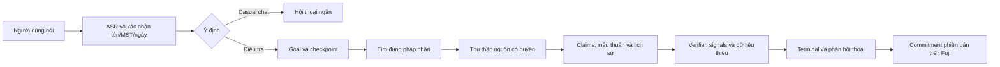

# MIRA + LANTERN VN

## Báo cáo nghiên cứu và phương án triển khai

**NoSleepClub · Team1 Avalanche · ngày 01/11/2026**

MIRA là tên làm việc cho trợ lý thoại tiếng Việt, phân biệt với NORA. LANTERN VN là tên làm việc cho terminal thông tin và thẩm định doanh nghiệp Việt Nam. Chưa kiểm tra nhãn hiệu. Báo cáo này phục vụ quyết định trước khi code; repo chưa có ứng dụng, hợp đồng dữ liệu, mô hình rủi ro đã kiểm định hoặc smart contract đã triển khai.

## 1. Phương án tôi đề xuất

Xây **trợ lý hội thoại MIRA + nền tảng bằng chứng LANTERN VN**, dùng dữ liệu chính thức/được cấp phép và workflow có trạng thái. Người dùng nói một yêu cầu; MIRA giữ mục tiêu, tìm đúng doanh nghiệp, thu thập và đối chiếu tài liệu, chỉ ra dấu hiệu cần kiểm tra và nói lại ngắn gọn. Terminal cho xem mọi nguồn, ngày, phép tính, mâu thuẫn và phần còn thiếu.

Phương án tốt nhất là **mua hoặc xin quyền phần dữ liệu khó; tự xây lớp định danh, bằng chứng theo thời điểm, orchestration, trải nghiệm voice và kiểm chứng**. Không tự crawl toàn bộ web để thay một data vendor, không xây hệ thống đa agent phức tạp trước khi có nguồn hợp lệ. Khởi đầu bằng một nhóm doanh nghiệp có dữ liệu đủ, rồi mở rộng lookup theo MST và hồ sơ sâu theo yêu cầu.

Mục tiêu dài hạn “xếp mọi doanh nghiệp Việt Nam từ ít rủi ro tới nhiều rủi ro tại thời điểm đầu tư” được giữ như hướng phát triển, nhưng chưa thể hứa hoàn thành bằng dữ liệu công khai hiện xác minh được. Một số doanh nghiệp phải ở trạng thái **không đủ dữ liệu để xếp hạng**. Ép chúng xuống cuối hoặc cho điểm an toàn đều gây hiểu nhầm.

Sản phẩm ban đầu nên phục vụ chuyên viên thẩm định doanh nghiệp/đối tác và nhà đầu tư cần kiểm tra nguồn, xuất **hồ sơ và tín hiệu rủi ro**. Chỉ mở thứ tự rủi ro tổng hợp sau khi có định nghĩa outcome, tập so sánh, dữ liệu/nhãn, kiểm định và đánh giá pháp lý. Điều này giữ đúng hướng terminal nghiên cứu doanh nghiệp mà tránh hứa một mô hình đầu tư chưa có căn cứ.

## 2. Đọc đề và đọc `zalo_hacks`

[Team1 UniHack](https://team1vn.xyz/) cho phép ý tưởng riêng hoặc dự án có sẵn, cần một phần thật chạy trên Avalanche. Hạn nộp là **23:59 ngày 21/11/2026, giờ Việt Nam**, không phải ngày chung kết 30/11. Nhóm tối đa ba người; cần repo, slides và video demo 2–3 phút mở xem được. Tích hợp Avalanche chiếm 25/100 điểm. [Đối chiếu đề và kế hoạch đáp ứng](docs/brief-nora-review.md) ghi chi tiết; chưa gửi bài hoặc đăng ký thay người dùng.

Đã đọc project `zalo_hacks` tại workspace NORA cục bộ và đối chiếu [repo NORA](https://github.com/dakiemdarktharr/NoSleepClub_zalo_hacks). Tài liệu cập nhật mô tả Rust native Windows, PTT, ASR/TTS local, goal/checkpoint, broker có kiểu dữ liệu, quyền và receipt verification. Một số tài liệu kiến trúc cũ vẫn nói phương án trước đây nên không được dùng làm trạng thái hiện tại. Chưa chạy lại test hoặc benchmark.

Phần nên kế thừa là **giữ mục tiêu, trả lời bổ sung vào đúng goal, checkpoint, kiểm quyền, đọc lại kết quả và chỉ thông báo việc đáng biết**. Phần cần xây mới là dữ liệu doanh nghiệp, entity resolution theo MST, nguồn được cấp phép, timeline, risk methodology và terminal. Số đo synthetic trong README NORA chưa chứng minh casual chat/full-duplex tiếng Việt đạt độ trễ hoặc chất lượng sản phẩm. [Nguồn trạng thái cập nhật](https://github.com/dakiemdarktharr/NoSleepClub_zalo_hacks/blob/main/docs/production-integration.md).

## 3. Bloomberg thực sự mang lại giá trị ở đâu

Một terminal tài chính kết hợp danh tính thực thể/công cụ, dữ liệu được chuẩn hóa, tài liệu và tin, công cụ tìm/so sánh/tính toán, lịch sử và quyền truy cập. Chatbot chỉ là một cửa vào. Giá trị khó sao chép nằm ở chất lượng, độ phủ, lịch sử, kiểm soát phiên bản và quyền dùng dữ liệu.

| Lớp năng lực công khai | Bloomberg cho biết gì | Bản tương ứng cần làm ở LANTERN VN |
|---|---|---|
| Tìm và mở đối tượng | Terminal có công cụ sàng lọc/phân tích; EQS, FA và EE có mô tả công khai | Tìm tên/MST/ticker → xác nhận entity → hồ sơ |
| Truy vấn và so sánh | BQL và công cụ AI/ASKB là hướng truy vấn, phân tích trong hệ sinh thái của họ | Lệnh thoại thành query có cohort, fields, ngày và điều kiện hiển thị |
| Reference data | Định danh, thuộc tính, quan hệ, sự kiện và phân loại | Entity master, alias, entity–instrument mapping, source/event history |
| Dữ liệu thị trường | B-PIPE là feed thời gian thực; Data License phục vụ các nhóm dữ liệu doanh nghiệp | Không cần realtime ticks cho MVP thẩm định; cần filings, pháp lý, tình trạng và lịch sử đúng |
| Quyền sử dụng | Các sản phẩm/feed có phạm vi riêng | Entitlement theo nguồn, tenant, trường, mục đích, cache và export |

Nguồn chính chủ: [Terminal](https://professional.bloomberg.com/products/bloomberg-terminal/), [EQS/FA/EE](https://professional.content.cirrus.bloomberg.com/professional2023/insights/technology/bloomberg-terminal-essentials-best-equities-functions/), [AI/ASKB](https://professional.bloomberg.com/products/bloomberg-terminal/ai/), [Reference data](https://professional.bloomberg.com/products/data/enterprise-catalog/reference/), [B-PIPE](https://professional.bloomberg.com/products/data/enterprise-catalog/real-time-data-feed/), [Data License](https://professional.bloomberg.com/products/data/data-license/). Đây là mô tả của vendor, không xác nhận độc lập chất lượng, quyền tái sử dụng hay coverage doanh nghiệp Việt Nam.

Nguồn dữ liệu tài chính thường thuộc nhiều lớp: sở giao dịch và đóng góp thị trường, hồ sơ doanh nghiệp/cơ quan quản lý, tin tức/nghiên cứu, nguồn mua/licence và dữ liệu được nhà cung cấp tính toán. Không có một “Bloomberg database miễn phí” để tìm và tải về. Thuê Terminal cũng không tự cấp quyền redisplay dữ liệu trong sản phẩm khác.

Vì vậy “reverse-engineer” ở đây là **phân rã năng lực và tái thiết kế workflow dựa trên thông tin công khai**. Chưa biết kiến trúc nội bộ, trọng số rủi ro, thuật toán matching hay hợp đồng nguồn của Bloomberg. Không truy cập hoặc sao chép phần mềm/dữ liệu độc quyền. [Phụ lục Bloomberg và nguồn dữ liệu](research/bloomberg-data.md) chỉ rõ phần xác minh được và phần chưa biết.

Bloomberg đã có công cụ AI; “thêm chat vào terminal” không đủ là điểm mới. Cơ hội của dự án là **tiếng Việt + thẩm định doanh nghiệp Việt Nam + provenance/as-of + xử lý thiếu dữ liệu + workflow giữ mục tiêu**. Chất lượng này phải được đo bằng tác vụ thực tế.

## 4. Dữ liệu doanh nghiệp Việt Nam: lấy ở đâu, tìm ra sao

| Nhu cầu | Nguồn ưu tiên | Giới hạn có ảnh hưởng trực tiếp |
|---|---|---|
| Danh tính/MST, tên cũ, đăng ký, tình trạng | [Cổng ĐKDN](https://dangkykinhdoanh.gov.vn/vn/Pages/Staticpage.aspx?key=dvc), sản phẩm thông tin có quyền | Lookup công khai không chứng minh có bulk API thương mại hay archive hoàn chỉnh |
| Trạng thái thuế, danh sách công khai | [Cổng người nộp thuế](https://tracuunnt.gdt.gov.vn/), cơ quan thuế theo phạm vi | Cổng bị timeout trong lượt mở trực tiếp; fields/API/nhịp hiện tại chưa xác nhận. Danh sách địa phương không đầy đủ toàn quốc |
| Tài chính, kiểm toán, quản trị, công bố | [HOSE](https://www.hsx.vn/), [HNX/UPCoM](https://www.upcom.hnx.vn/vi-vn/huong-dan/chi-tiet-thu-tuc-22-39.html), [SSC](https://www.ssc.gov.vn/), IR doanh nghiệp | Chủ yếu công ty đại chúng/niêm yết; riêng lẻ khác hợp nhất, quý không tự là kiểm toán |
| Dấu vết kinh doanh/đấu thầu | [Hệ thống mạng đấu thầu quốc gia](https://muasamcong.mpi.gov.vn/), hồ sơ công bố và dữ liệu chủ DN có quyền cung cấp | Trúng thầu không chứng minh thực hiện, doanh thu hay dòng tiền |
| Pháp lý và thi hành án | [Cổng công bố bản án](https://congbobanan.toaan.gov.vn/), [THADS](https://thads.moj.gov.vn/), quyết định có thẩm quyền | Có thể ẩn danh/thiếu kết cục, phải phân biệt cáo buộc, sơ thẩm, hiệu lực và sửa/hủy |
| Quan hệ, thương mại, doanh nghiệp tư nhân | Nguồn công bố, tài liệu được cấp quyền, vendor/licence | Ngành đăng ký ≠ hoạt động thật; shared director ≠ giao dịch; shipment/invoice toàn quốc không được chứng minh là nguồn mở |
| Tín dụng | CIC hoặc nguồn hợp pháp theo đối tượng/quyền | Không phải tra mọi DN bằng MST; quyền access/use/resell riêng, nghĩa vụ chuyên ngành riêng |
| Dữ liệu tổng hợp thương mại | [FiinGate](https://fiingroup.vn/en/fiingate.html), [FiinPro-X](https://fiingroup.vn/en/fiinpro-x.html), Vietstock và vendor khác đã đối chiếu | Claims coverage/AI/API phải kiểm mẫu và hợp đồng; trang sản phẩm không cấp quyền chatbot |

Ma trận đầy đủ về fields, API đã/chưa xác minh, lịch sử, cập nhật, quyền và nhà cung cấp nằm tại [bloomberg-data.md](research/bloomberg-data.md). Không đưa giá feed chưa có báo giá thật. Không nhận định một provider chắc chắn đáp ứng mọi doanh nghiệp chỉ từ giới thiệu thương mại.

### Cách tìm và phân giải

Dùng `entity_id` nội bộ; MST/mã số doanh nghiệp được xác minh là định danh quan trọng trong phạm vi đăng ký Việt Nam, phân biệt đơn vị phụ thuộc với pháp nhân và lưu mapping theo thời gian. Ticker/ISIN/FIGI thuộc công cụ tài chính. [OpenFIGI](https://www.openfigi.com/api/documentation) không là danh mục mọi pháp nhân Việt Nam. Tên bỏ dấu/viết tắt/tên cũ dùng tạo ứng viên, không dùng làm căn cứ gộp chắc chắn. Cần tách công ty mẹ, công ty con, chi nhánh, người đại diện và công cụ phát hành.

Tìm exact ID → tên chuẩn/alias theo tỉnh/thời kỳ → source-specific searches → mở tài liệu gốc. Search snippets dùng khám phá, không đủ để kết luận bất lợi. Mỗi claim phải có entity, giá trị/đơn vị/kỳ, nguồn, đoạn/trang, ngày và trạng thái xác minh. Giữ tài liệu gốc chỉ trong quyền lưu; thiếu quyền không được tự thu thập hàng loạt.

Đối với “hoạt động buôn bán”, hệ thống phải trả lời rõ đang thấy bằng chứng loại nào: hoạt động đăng ký, tự công bố, hợp đồng/đấu thầu, khách hàng/nhà cung cấp được nêu trong báo cáo, hay dữ liệu giao dịch được cấp quyền. Không suy từ hai công ty có cùng lãnh đạo thành có giao dịch; không chuyển số liệu xuất khẩu ngành thành doanh thu một doanh nghiệp.

### Scale hợp lý

Lớp nền là danh mục định danh và metadata được phép; lớp sâu chỉ chạy khi người dùng mở dossier, chọn watchlist hoặc có thay đổi đáng chú ý. Refresh theo nguồn/delta và độ quan tâm, dedup theo tài liệu/sự kiện. Nếu chưa có bulk licence, lookup on-demand là phạm vi thật; chưa thể gọi là phủ toàn quốc.

Những doanh nghiệp không có BCTC hoặc lịch sử pháp lý đủ vẫn có thể có hồ sơ nhận diện, checklist và khoảng trống. Độ phủ phải hiện ở cấp trường/nguồn, không chỉ một phần trăm toàn cục làm người dùng hiểu nhầm dữ liệu đầy đủ.

## 5. Nghiên cứu mới nói gì

Tổng quan gồm **21 nguồn học thuật**, ưu tiên 2025–2026, có công trình nền cũ. Không phải 21 nghiên cứu đã xác nhận sản phẩm; phần lớn chưa thử trên doanh nghiệp Việt Nam. [Bảng chú giải học thuật](research/academic-evidence.md) có ngày/version, dạng peer-reviewed/preprint, nội dung đã đọc, cỡ mẫu, chỉ số và giới hạn; [RIS](research/papers.ris) hỗ trợ nhập Zotero.

| Hướng | Nguồn tiêu biểu | Điều nên dùng / điều không được suy ra |
|---|---|---|
| Tìm bằng chứng tài chính | [FinSearchComp 2025](https://arxiv.org/abs/2509.13160), [HiREC/LOFin 2025](https://aclanthology.org/2025.findings-acl.855/), [FinRank 2026](https://arxiv.org/abs/2608.07400) | Chấm đúng entity, kỳ, đoạn nguồn và hard negatives; đúng đáp án chưa chứng minh đúng evidence |
| Financial agents | [FinRobot](https://arxiv.org/abs/2411.08804), [ICBCBench 2026](https://arxiv.org/abs/2606.17458) | Vai trò và rubric báo cáo là prior art; chưa chứng minh hiệu quả đầu tư hoặc tương đương Bloomberg |
| Tiếng Việt | [VietSuperSpeech 2026](https://arxiv.org/abs/2603.01894), [Vietnamese ASR Revisit 2026](https://aclanthology.org/2026.findings-eacl.345/) | Cần nhãn người và tiếng nói tự nhiên; pseudo-label hoặc chất lượng transcript không phải WER sản phẩm |
| Thoại tự nhiên | [FLEXI 2025](https://arxiv.org/abs/2509.22243), [DuplexSLA 2026](https://arxiv.org/abs/2605.20755) | Đo turn-taking, interruption và đúng tool cùng latency; full-duplex không tự tốt hơn cascade |
| Graph/temporal | [GraphRAG-Bench](https://arxiv.org/abs/2506.05690), [DyG-RAG](https://arxiv.org/abs/2507.13396) | Thử graph khi câu hỏi quan hệ cần; chặn lỗi matching và thời gian. GraphRAG-Bench mới đọc abstract |
| Bất định và an toàn | [TRAQ](https://aclanthology.org/2024.naacl-long.210/), [InjecAgent](https://aclanthology.org/2024.findings-acl.624/), [NDSS tool-selection attack 2026](https://www.ndss-symposium.org/ndss-paper/prompt-injection-attack-to-tool-selection-in-llm-agents/) | Đo coverage/abstention, injection qua dữ liệu và metadata; conformal có giả định, không bảo đảm từng kết luận |
| Distress/credit thực nghiệm | Bốn nguồn Việt Nam, Indonesia, graph Trung Quốc và corporate Italy trong [mục 18–21](research/academic-evidence.md) | Nhãn/horizon rất khác nhau; proxy kế toán, sự kiện pháp lý và default không được đồng nhất |

Một vài số liệu minh họa lý do cần thiết kế phép đo đúng: FinanceBench thử 150 câu công khai/16 cấu hình và một cấu hình cũ sai **hoặc từ chối** 81%; đó không là hallucination rate của model hiện tại. Trên toàn bộ 900 ca tool-use, DuplexSLA báo accuracy action 85,56%, cascade đạt 91,33%; delay tương ứng 0,64 và 2,77 giây chỉ được tính trên các hành động khớp. Không dùng một chỉ số tốc độ để bỏ qua việc gọi sai công cụ. [FinanceBench](https://arxiv.org/abs/2311.11944), [DuplexSLA](https://arxiv.org/abs/2605.20755).

Nghiên cứu Việt Nam tìm được dùng proxy khó khăn tài chính như EBIT thấp hơn lãi vay; chưa đủ căn cứ để gọi là dự báo default tương lai. Predictor cùng kỳ có thể tái tạo công thức nhãn. Những nghiên cứu quốc tế có mẫu hiếm hoặc nhãn composite cũng không tự chuyển thành PD của mọi doanh nghiệp Việt Nam. Chưa tìm được bằng chứng trực tiếp end-to-end cho hệ thống full-duplex tiếng Việt + due diligence doanh nghiệp Việt Nam. Đây là khoảng trống cần thử nghiệm, không phải bằng chứng dự án sẽ thất bại.

## 6. MIRA xử lý một yêu cầu như thế nào

MIRA phải chuyển mượt từ trò chuyện sang giao việc và quay lại. Trong lúc tìm tài liệu, người dùng có thể hỏi kiến thức hoặc đổi ngày chốt; goal nhận version mới, bước phụ thuộc cần chạy lại, kết quả cũ không bị trình bày như đáp ứng yêu cầu mới. “Dừng nói” khác “hủy mục tiêu”. Một task dài không chặn microphone/casual chat, nhưng ngân sách và số goal đồng thời có trần.

Giọng nói dùng để giao việc và tóm tắt, terminal chứa bằng chứng. MIRA không đọc cả bảng chỉ số hoặc URL dài; nói điều đáng chú ý, giới hạn dữ liệu và chỉ vào evidence card. Nếu người dùng hỏi “nên mua mã nào?”, giữ ranh giới sản phẩm và chuyển về dữ kiện/tiêu chí có thể kiểm tra; không dự báo return hay biến score thành khuyến nghị mua/bán.

Kiến trúc ưu tiên: web terminal cho demo dễ mở; voice cascade có transcript; backend workflow persistent; PostgreSQL + lexical/vector retrieval; object store có quyền; graph quan hệ trong bảng; rules deterministic và verifier. Client NORA Windows nối vào domain API giai đoạn sau hoặc sớm hơn nếu spike chứng minh ít công hơn. [Kiến trúc chi tiết và data contracts](docs/architecture-workflows.md) mô tả state machine, adapters, budget/timeout/retry, bảo mật và chuỗi sự kiện.

Không fine-tune LLM để “nhớ” mọi doanh nghiệp: facts đổi theo thời gian và quyền nguồn. Đầu tiên dùng retrieval + structured tools + phép tính có kiểm soát; fine-tune chỉ xem xét khi có bộ lỗi lặp, nhãn và phép thử chứng minh có lợi.

## 7. Xếp hạng rủi ro theo thời điểm

“Rủi ro” phải trả lời bốn câu: **rủi ro sự kiện gì, trong bao lâu, so với nhóm nào, dựa trên dữ liệu nào?** Khả năng bị xử phạt, khó khăn tài chính, vi phạm nghĩa vụ nợ, gian lận và lợi nhuận cổ phiếu không là cùng một target. Công ty tài chính khỏe vẫn có cổ phiếu sinh lời kém vì giá mua; xếp hạng pháp lý thấp không bảo đảm đầu tư an toàn.

### Từ hồ sơ đến thứ tự có ý nghĩa

1. **V0 — hồ sơ/tín hiệu:** các chiều riêng về nhận diện/tình trạng, thuế, pháp lý, tài chính, vận hành và quan hệ. Mỗi chiều có evidence/status/age/missingness. Không đưa xác suất tự sinh.
2. **V0.5 — ưu tiên rà soát nội bộ:** sau review pháp lý và chuyên viên, dùng decision table có version trong một cohort rõ. Giữ ties/bands, lý do và `unrankable`; chưa gọi là xác suất vỡ nợ hay “an toàn nhất Việt Nam”.
3. **V1 — mô hình một outcome xác định:** chỉ khi có nhãn lịch sử/horizon, quyền dữ liệu và điều kiện kinh doanh. So logistic/gradient boosting với rules; graph/GNN là thử nghiệm bổ sung. Hiệu chỉnh ngoài mẫu và theo ngành/quy mô.
4. **Mở rộng quốc gia:** lookup có quyền phủ rộng trước; coverage rủi ro tăng theo dữ liệu thực. Báo cả quần thể chưa xếp được. Không công bố một total ordering toàn quốc khi cơ sở so sánh không đồng đều.

Không coi missing như risk = 0; không nhân severity vì cùng một bài báo được sao chép nhiều nơi; không dùng bản án đã sửa/hủy như sự kiện còn hiệu lực. Với kết luận bất lợi, false merge có thể gây tổn hại lớn hơn một câu hỏi làm rõ, nên ưu tiên precision và quyền phản hồi/sửa sai.

### Hai thời điểm không được trộn

Câu “thực tế công ty thế nào ở T, theo những gì hôm nay đã biết” khác câu “ngày T một người có thể biết gì”. Cần valid time, publication time, ingestion/recorded time và version. Quyết định hiệu lực tháng 3 nhưng công bố tháng 4 không được xuất hiện như thông tin công khai vào tháng 3. Financial period end không là ngày nhà đầu tư biết báo cáo.

LANTERN hiển thị chế độ as-of: public-knowable, system-knew hoặc retrospective. Không có archive/timestamp đủ thì nói không tái dựng chắc được. Model/policy version và training cutoff cũng cần lưu. Đây là điều kiện thiết kế cho truy vấn lịch sử và kiểm định; chưa có dữ liệu để chứng minh khả năng replay toàn bộ doanh nghiệp Việt Nam.

## 8. Vì sao không làm “cổ phiếu return cao nhất”: pháp lý và chất lượng

Lý do hợp lý là chọn một vấn đề có đầu ra kiểm chứng được và phạm vi pháp lý rõ hơn, chứ không phải thay tên để tạo miễn trừ. Return cao nhất tương lai không có ground truth tại thời điểm tư vấn, phụ thuộc giá/khẩu vị/horizon, và có thể đi vào tư vấn chứng khoán. Thẩm định doanh nghiệp tạo bằng chứng giúp người dùng tự đánh giá, nhưng nếu kết quả thực chất khuyến nghị mua/bán hoặc chấm khả năng trả nợ thì nghĩa vụ vẫn có thể áp dụng.

- Khoản 32 Điều 4 Luật Chứng khoán mô tả tư vấn qua phân tích/báo cáo và khuyến nghị liên quan mua, bán, nắm giữ. Cần xét luật sửa đổi và trải nghiệm thực tế, không chỉ disclaimer. [Luật 54/2019/QH14](https://datafiles.chinhphu.vn/cpp/files/vbpq/2019/12/54.signed.pdf).
- Đánh giá khả năng thực hiện nghĩa vụ nợ có thể liên quan khung dịch vụ xếp hạng tín nhiệm; cung ứng thông tin tín dụng có khung khác. Tên “risk score”, B2B hay báo cáo riêng không tự tạo ngoại lệ. [NĐ 88/2014](https://vanban.chinhphu.vn/default.aspx?docid=176321&pageid=27160), [NĐ 58/2021](https://congbaocdn.chinhphu.vn/CongBaoCP/VanBan/2021/6/33836/36011-1-2021645-64658-2021-nd-cp.pdf); phụ lục ghi sửa đổi/hiệu lực đã và chưa kiểm.
- Luật BVDLCN 91/2025 và NĐ 356/2025 là khung cần xét trong năm 2026; không chỉ dựa NĐ 13/2023 cũ. Cần sơ đồ data flow của audio/transcript, dữ liệu người đại diện và API bên ngoài, cơ sở xử lý, retention và quyền sửa/xóa. [Luật 91](https://datafiles.chinhphu.vn/cpp/files/vbpq/2025/7/91qh.signed.pdf), [NĐ 356 trên Công báo](https://congbaocdn.chinhphu.vn/180507251028987904/2026/1/17/cong-bao-so-18-ngay-18-01-46924signed-1768637757042330005940.pdf).
- Luật AI 134/2025 và văn bản 2026 cần được đối chiếu theo mục đích thực. Chưa tự gán “AI rủi ro thấp” hoặc “mọi scoring đều rủi ro cao”. [Luật AI](https://vanban.chinhphu.vn/?classid=1&docid=216334&pageid=27160&typegr=), [NĐ 142/2026](https://datafiles.chinhphu.vn/cpp/files/vbpq/2026/4/142-2026-ndcp.signed.pdf).

[Phụ lục pháp lý](research/legal-feasibility.md) nêu chính xác văn bản, phần sửa đổi, QĐ 33/2026, điều kiện cần luật sư đối chiếu và giới hạn nguồn. Đây là phân tích sơ bộ cho thiết kế, chưa phải xác nhận đủ điều kiện kinh doanh. Prototype bằng dữ liệu tổng hợp không bị biến thành một dự án thương mại chỉ vì nghiên cứu này nêu các cổng pháp lý.

## 9. Tích hợp Avalanche có tác dụng gì

Chọn một **registry kiểm chứng phiên bản báo cáo trên Fuji**, không cần L1/token riêng. Dữ liệu và báo cáo ở ngoài chuỗi có quyền truy cập; trên chuỗi chỉ commitment tổng hợp có salt ngẫu nhiên, schema/version và metadata tối thiểu. Không đưa MST/tên/score/audio/transcript hoặc hash dễ dò lên chuỗi. Salt và pseudonym không bảo đảm ẩn danh; metadata, proof và việc chia sẻ vẫn có thể tạo liên kết, phải đánh giá trước pilot. Đường verify cần có bằng chứng Merkle, canonicalization và receipt; hỗ trợ bản sửa/supersede, không hứa xóa được root cũ.

Demo nên chứng minh: báo cáo gốc verify được, sửa một byte làm fail, bản đính chính có phiên bản mới và history rõ. Issuer phải được xác thực, quyền ghi và chữ ký/supersession phải được kiểm; relayer address không tự chứng minh tác giả. Hash chỉ chứng minh tính toàn vẹn/sự tồn tại của dữ liệu đã commit trong giả định chain; không chứng minh nguồn đúng, dữ liệu đầy đủ, xếp hạng đúng hoặc được phép sử dụng. [Fuji C-Chain trong tài liệu Avalanche](https://build.avax.network/docs/primary-network).

Giá trị thực là người đọc phát hiện báo cáo bị thay sau khi phát hành và biết phiên bản nào bị thay thế. Signed audit log thông thường cũng giải quyết một phần nhu cầu; blockchain không là điều kiện để AI nghiên cứu đúng. Cần xác nhận với mentor độ phù hợp tích hợp vì nó chiếm 25 điểm. Không thêm crypto payment/x402/treasury trong MVP; những chức năng này tăng scope và bài toán pháp lý mà chưa giúp thẩm định doanh nghiệp tốt hơn.

## 10. So các hướng triển khai

| Hướng | Lợi ích | Điểm nghẽn | Kết luận |
|---|---|---|---|
| Chỉ prompt + web search | Dựng demo rất nhanh | Trùng tên, nguồn/rights/temporal thiếu kiểm soát, không có universe/nhãn | Dùng làm baseline; không phải nền sản phẩm |
| Crawl quốc gia + nhiều agent + GNN ngay | Có vẻ bao quát và mới | Quyền, thiếu dữ liệu, nhãn, matching và chi phí chưa giải quyết | Không ưu tiên cho hackathon hoặc v0 |
| Chỉ mua terminal/feed rồi thêm voice | Có dữ liệu từ vendor | Redisplay/AI licensing và phạm vi private SME; ít khác biệt | Dữ liệu là thành phần, không đủ toàn sản phẩm |
| Hybrid: nguồn có quyền + evidence/goal engine tự xây | Kiểm được chất lượng và chi phí, mở rộng dần | Cần thỏa thuận dữ liệu và đo thực nghiệm | **Phương án ưu tiên** |

Stack được chọn ở mức nghiên cứu: một web client, một backend modular monolith và persistent workflow, PostgreSQL + object storage + hybrid retrieval, audio adapters, typed tools, deterministic calculations, optional Fuji registry. Chưa chốt cloud/data provider, chưa provision hay trả phí. Không có lý do kỹ thuật phải dựng tất cả framework hoặc microservices từ đầu.

## 11. Độ khả thi và “thành công” cần hiểu thế nào

Không có căn cứ để đưa xác suất thành công kiểu 80–90%. Chưa có dữ liệu pilot, đội triển khai, hợp đồng nguồn hoặc performance end-to-end. Đánh giá định tính dưới đây là nhận định thiết kế có điều kiện.

| Mục tiêu | Khả thi kỹ thuật hiện nhận định | Điều kiện quyết định |
|---|---|---|
| Casual voice tiếng Việt + tạo/resume goal | Khá rõ hướng làm, chất lượng chưa đo | Live-mic, critical slots, interruption, latency đúng model/thiết bị |
| Dossier có nguồn cho nhóm DN dữ liệu tốt | Có thể triển khai phạm vi hẹp | Nguồn có quyền, identity/citation/date checks, người rà |
| Tìm DN theo MST trên diện rộng | Phụ thuộc dữ liệu/access | Có quyền lookup/bulk, coverage và lịch cập nhật xác nhận |
| Tái dựng dữ liệu tại một thời điểm lịch sử bất kỳ | Chưa có căn cứ đầy đủ | Archive/version/publication timestamps và quyền lưu lịch sử |
| Risk screening/so sánh cohort | Có thể nghiên cứu sau gates | Use case/pháp lý rõ, rubric, missingness, kiểm định chuyên viên |
| PD/xếp mọi DN VN thành 1–N | Chưa đủ cơ sở | Nhãn/horizon/coverage/licence, calibration và phạm vi kinh doanh |
| Sản phẩm thương mại có người trả tiền | Chưa kiểm chứng | Pilot giảm công việc có đo, dữ liệu/licence/human review cost và willingness to pay |

Go cho prototype evidence-first. Go có điều kiện cho pilot nguồn thật. No-go cho claim “xếp mọi doanh nghiệp chính xác” hoặc “an toàn pháp lý vì chỉ chấm risk” ở thời điểm này. Các cổng này không phủ nhận mục tiêu dài hạn; chúng xác định phần nào cần chứng minh tiếp.

KPI pilot ưu tiên: đúng entity/kỳ, evidence support, coverage và abstention, thời gian chuyên viên tiết kiệm mà không tăng lỗi trọng yếu, chi phí/goal, và khả năng người dùng kiểm tra kết luận. Với V1 predictive, thêm PR-AUC, calibration/Brier, temporal holdout, drift và nhãn censoring. [Kế hoạch đánh giá](docs/evaluation-roadmap.md) có cỡ thử đề xuất, mục tiêu gate và giới hạn thống kê; chưa có kết quả đạt ngưỡng.

## 12. Việc cần làm theo thứ tự

1. **02–04/11:** cố định use case, vài truy vấn quan trọng, mẫu dossier và nguồn có quyền; spike voice; kiểm với mentor phần Fuji.
2. **05–12/11:** text dossier + định danh + evidence trước, rồi voice/casual/durable workflow; giữ phạm vi 30–50 DN thiết kế và vài hồ sơ tư nhân có quyền, chưa coi là mẫu toàn quốc.
3. **13–18/11:** Fuji registry và phép verify/tamper; chạy held-out evaluation, lỗi as-of và injection; thu phản hồi chuyên viên.
4. **19–21/11:** chốt scope, slides/video/link mở được và nộp trước deadline. Không đánh đổi dữ liệu thật/claim đúng để thêm giao dịch hay nhiều agent.
5. **Sau hackathon:** xác nhận quyền dữ liệu, review pháp lý/điều kiện kinh doanh và nghĩa vụ AI theo use case trước pilot nguồn thật hoặc trả phí; xây live voice corpus và vận hành. Sau khi các cổng này đạt, quyết định có dữ liệu đủ để xây risk model dự báo và mở rộng coverage.

Ưu tiên kiểm chứng trước khi code lớn: có quyền dữ liệu nào, chuyên viên có giảm được thời gian kiểm tra, matching sai bao nhiêu, lịch sử có tái dựng được, và chi phí có phù hợp không. Một UI giống Bloomberg sẽ không giải quyết được các câu hỏi này.

## 13. Deliverables, công cụ và giới hạn

Repo public được tạo đúng tên **[NoSleepClub_team1avalanche](https://github.com/dakiemdarktharr/NoSleepClub_team1avalanche)**, kèm README, báo cáo này, [kiến trúc/workflows](docs/architecture-workflows.md), [đánh giá/chi phí/roadmap](docs/evaluation-roadmap.md), [đề/NORA](docs/brief-nora-review.md), ba phụ lục chuyên môn và thư mục RIS.

Ba agent chuyên môn áp dụng Agency Agents và dùng `gpt-6.1-terra / xhigh` theo yêu cầu. **CoChat đã được dùng** để tìm/fetch và đối chiếu paper gốc. **Consensus đã được gọi nhưng hết quota**; không có kết quả Deep Research từ Consensus. **Zotero không có plugin khả dụng** sau tìm kiếm; chưa đồng bộ tài khoản, RIS là phương án nhập tài liệu. [Phương pháp và nhật ký khả năng công cụ](research/methodology.md) ghi giới hạn này, full-text/abstract-only và nguồn bổ sung.

Chưa mua feed, thu dữ liệu toàn quốc, benchmark lại NORA, chạy user study, huấn luyện risk model, code sản phẩm, triển khai contract, nộp bài thi hay liên hệ vendor. Những khâu đó nằm trong kế hoạch với điều kiện cụ thể. Báo cáo là nền để chọn phạm vi thực hiện và kiểm chứng tiếp, không phải chứng nhận sản phẩm đã sẵn sàng.
