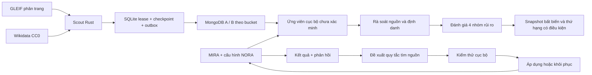

# MIRA và LANTERN: bản triển khai ngày 02/11/2026

Bản này đưa vòng cải thiện truy vấn, sàng lọc rủi ro và nguồn miễn phí mới vào ứng dụng Rust hiện có. HTML vẫn render bằng Rust/Maud; JavaScript xử lý trình duyệt. Ngân sách API tối đa giữ ở $5, không mua feed.

## Pipeline thực tế

Scout giữ namespace `gleif:` và `wikidata:` riêng. Nguồn không tự xác nhận MST, không ghép pháp nhân theo tên và không tự tạo cáo buộc. Hai cluster lưu bản ghi idempotent; SQLite giữ trạng thái rà soát hiện tại. Nhật ký rủi ro và learning vẫn nằm cục bộ, chưa được sao lưu sang MongoDB. Trạng thái nguồn, lịch, quota, cursor và công việc chờ được hiển thị riêng.

## Sàng lọc rủi ro

Người dùng thêm URL và dữ kiện hoặc dùng bằng chứng từ MIRA, đối chiếu đúng chủ thể, rồi ghi đánh giá có người rà soát và căn cứ. Một nguồn chỉ dùng cho đúng chiều của nó. Bốn chiều là pháp lý, thuế, tài chính và hoạt động; định danh là điều kiện riêng. Nguồn không có ngày, đã cũ, chưa được rà soát hoặc bị loại không được dùng để tạo mức quan ngại. Nguồn chỉ có ngày công bố được xử lý theo cuối ngày Việt Nam để tránh dùng thông tin quá sớm.

Điểm sàng lọc 0–3 lấy mức cao nhất trong bốn chiều, không phải xác suất. Chỉ hồ sơ đủ bốn chiều và định danh mới có thứ hạng; còn lại hiện “Chưa đủ điều kiện”. Xếp toàn nhóm tối đa 1.000 hồ sơ trước khi chia trang 100; trên giới hạn sẽ báo rõ phần chưa được xét. Không có dữ liệu xấu không đồng nghĩa an toàn. Phương pháp này chưa được hiệu chỉnh theo outcome và không so được mọi loại rủi ro giữa các ngành như một mô hình tín nhiệm.

Snapshot lưu cutoff, căn cứ, phiên bản phương pháp và tên được ghi nhận lúc tạo. Thu hồi hoặc loại nguồn làm thay đổi bản xem hiện tại, không sửa phiên bản cũ. Khi đọc phiên bản cũ cần đối chiếu các sửa đổi sau thời điểm tạo. Chi tiết: [phương pháp](RISK_METHODOLOGY.md).

## Vòng cải thiện agent

Mỗi lượt nghiên cứu gắn với phiên bản cấu hình đã chọn trước request. Kết quả chỉ được phân loại thành nhập được dữ liệu, thiếu bằng chứng, sai pháp nhân hoặc lỗi nguồn; nhập được dữ liệu chưa có nghĩa là đúng. Phản hồi được nhập từ màn Cải thiện, không lấy chỉ thị từ nội dung web làm memory.

Đủ ít nhất sáu lượt và ba lỗi tương ứng mới có thể đề xuất một trong các quy tắc tìm nguồn được biên dịch sẵn. Kiểm thử cục bộ kiểm tra các chỉ dẫn và hồi quy; không gọi thêm model hoặc tự áp dụng. Người vận hành có thể áp dụng rồi khôi phục. Khôi phục giữ lại phần quy tắc bị bỏ đến khi có ba lỗi mới tương ứng; không dùng lại phản hồi cũ để lặp đề xuất. Có nhật ký, giới hạn memory và chống tính lại run ID trong cửa sổ lưu giữ.

Đây là cải thiện scaffold có kiểm soát, chưa phải RSI tự sửa chương trình hoặc tự huấn luyện model. Chưa có bằng chứng đối chứng rằng cấu hình mới tăng độ chính xác. Các vấn đề về thay đổi có ích trong một tác vụ nhưng gây lỗi ở tác vụ sau cũng được nghiên cứu trong [SEABench, preprint 2026](https://app.cochat.ai/from/chatgpt/search/papers/10.48550/arxiv.2609.35596), đã đọc qua CoChat. Chi tiết và giới hạn: [Evolution](EVOLUTION.md).

## Giao diện và lỗi đã xử lý

- Có màn Rủi ro, Cải thiện, form thêm nguồn và nhật ký rà soát; nội dung dài đặt trong phần mở rộng.
- Danh sách có phân trang; tìm kiếm cục bộ và watchlist truy vấn toàn kho thay vì chỉ trang đầu. So sánh giới hạn 2–4 hồ sơ rõ ràng.
- Giữ bản nháp và trạng thái mở form khi điều hướng hoặc refresh. Browser Back/Forward giữ trang, cutoff và ID snapshot.
- Poll chỉ lấy revision digest, không tải lại toàn bộ bằng chứng mỗi năm giây. Chỉ dossier đang mở tải bằng chứng chi tiết.
- Escape hủy bản ghi và không gửi phiên âm; các mutation không tự retry. Sửa tràn thanh tìm kiếm trên màn hình hẹp và ngăn focus vào panel đang đóng.
- Khôi phục nguồn sau rà soát xử lý cả 403, hết retry và 429, vẫn giữ quota và Retry-After. Migration phân trang vô hiệu hóa lease cũ.

## API mới

Các route là API của server loopback một người dùng, giữ kiểm tra Host/Origin hiện có. GET không gọi model.

| Route | Tác dụng |
| --- | --- |
| `POST /api/evidence` | Lưu nguồn do người dùng nhập, chưa xác minh |
| `POST /api/risk/assessments` | Ghi mức quan ngại theo bằng chứng |
| `POST /api/risk/identity` | Ghi hoặc rút quyết định định danh |
| `POST /api/risk/assessments/{id}/retract` | Thu hồi đánh giá, giữ lịch sử |
| `POST /api/risk/snapshots` | Lưu nhóm tối đa 1.000 ID cùng cutoff |
| `GET /api/risk/snapshots/{id}` | Đọc phiên bản đã lưu |
| `GET /api/evolution` | Phiên bản, kết quả, feedback và audit |
| `POST /api/evolution/evaluate` | Tạo/kiểm tra đề xuất khi đủ điều kiện |
| `POST /api/evolution/promote` / `rollback` | Thay phiên bản tìm nguồn |
| `POST /api/evolution/runs/{id}/feedback` | Lưu phản hồi tác vụ đã kết thúc |
| `POST /api/scout/sources/{id}/enabled`, `/run`, `/resume-after-review` | Điều khiển từng nguồn, giữ hạn mức |
| `GET /api/revision` | Digest cho cập nhật giao diện |

Các kiểm thử và giới hạn nghiệm thu được cập nhật tại [VALIDATION.md](VALIDATION.md). Bước tiếp theo là bộ nhãn độc lập cho đánh giá độ đúng, nguồn thuế/pháp lý có quyền sử dụng rõ ràng, backup/restore, và deployment Fuji khi có test AVAX. Không có cam kết phủ toàn quốc hoặc production trong bản này.
