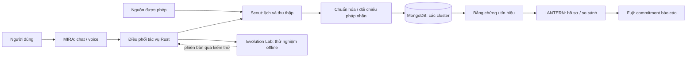

# Kế hoạch phát triển tiếp theo: MIRA + LANTERN VN

**Tổng hợp ngày 02/11/2026.** Tài liệu này kết nối yêu cầu sản phẩm, mã hiện có và các nghiên cứu đã thực hiện. Đây là kế hoạch; không có nghĩa những hạng mục đề xuất đã được triển khai hoặc nghiệm thu.

**Cập nhật triển khai:** đã có hai nguồn Scout miễn phí và quét phân trang, vòng cải thiện truy vấn có áp dụng/khôi phục, và pipeline sàng lọc theo bằng chứng do người dùng rà soát. Xem [bản triển khai](IMPLEMENTATION_2026-11-02.md) để phân biệt với các mục kế hoạch bên dưới. Tiếp theo cần dữ liệu outcome/nhãn độc lập, kiểm định model đối chứng khi có ngân sách, và test AVAX để triển khai Fuji. Không tự mua feed hoặc nâng ngân sách.

## Mục tiêu và quyết định đã thống nhất

- **MIRA** là trợ lý tiếng Việt để trò chuyện và giao việc. **LANTERN VN** là terminal điều tra doanh nghiệp, có bằng chứng và so sánh; **Scout** là worker theo dõi nguồn; **Evolution Lab** là vòng thử nghiệm cải thiện agent.
- Giữ web/PWA và ưu tiên Rust cho backend, workflow, thu thập, lưu trữ và HTML server-rendered. JavaScript chỉ làm phần trình duyệt cần thiết. Không tự đổi model chat và reasoning của cấu hình NORA được chọn.
- Giao diện tối giản, bỏ subtext trang trí. Giữ tên nguồn, thời điểm, trạng thái và dữ liệu thiếu vì chúng cần cho quyết định của người dùng.
- Dữ liệu có thể phân bố trên **nhiều MongoDB cluster độc lập**. Tích hợp Avalanche phải có giao dịch kiểm chứng thật trên mạng phù hợp; ưu tiên Fuji cho demo.
- Chưa mua feed dữ liệu. Hạn mức **5 USD chỉ áp dụng cho kiểm thử API đã được cho phép**, không mặc định là ngân sách duy trì dịch vụ hay hạ tầng. Không tự nâng hạn mức hoặc sử dụng nguồn trả phí.
- Mục tiêu dài hạn là so sánh và xếp hạng rủi ro doanh nghiệp Việt Nam theo thời điểm, nhưng thứ hạng chỉ có ý nghĩa khi có phạm vi dữ liệu, định nghĩa rủi ro và kiểm định phù hợp. Không có tin xấu không đồng nghĩa ít rủi ro.

## Hiện trạng

| Đã có mã / đã thử ở phiên trước | Chưa có hoặc chưa được xác nhận |
|---|---|
| Web/PWA cục bộ Rust, 8 view, MIRA chat và push-to-talk; transcript sửa được. | Giao diện vẫn cần giản lược; chưa có voice streaming hai chiều được nghiệm thu. |
| Tra cứu và điều tra theo tác vụ, bằng chứng gắn tác vụ, rà soát chủ thể, watchlist, trạng thái và ledger trong SQLite. | Scout chạy liên tục, feed/nguồn được cấp quyền, MongoDB, multi-cluster và lịch sử đầy đủ theo thời điểm. Watchlist hiện chưa tự cập nhật. |
| So sánh trường đã có; xuất báo cáo và commitment cục bộ. | Mô hình rủi ro được kiểm định, xếp hạng toàn quốc, tập nhãn chuyên gia và kiểm thử ngoài mẫu. |
| Mã `ReportVersionRegistry`, chuẩn bị giao dịch và kiểm receipt. | Contract đã deploy, giao dịch Fuji thật, hoặc chứng minh đã neo on-chain. |
| Bộ kiểm thử và kết quả thử chat/giọng tổng hợp trong [VALIDATION](VALIDATION.md). | Đánh giá người dùng, chất lượng micro tiếng Việt, audit accessibility và kiểm thử production. |

Ngày quá khứ hiện chưa có snapshot đầy đủ, nên ứng dụng ẩn hồ sơ và tác vụ thay vì dựng lại lịch sử. Rà soát **đúng chủ thể** không tự xác minh nội dung claim.

## Luồng sản phẩm dự kiến

MIRA xử lý câu xã giao trong chat; yêu cầu nghiên cứu tạo tác vụ có trạng thái. Khi tên mơ hồ, người dùng chọn pháp nhân bằng thông tin có nguồn. Scout có thể tiếp tục khi cửa sổ chat đóng, nhưng muốn chạy khi máy tắt phải có worker và máy chủ luôn hoạt động được cấu hình riêng.

## Các phần cần phát triển

### 1. Nguồn, Scout và kho bằng chứng

- Lập danh mục nguồn với quyền truy cập, tự động thu thập, lưu, hiển thị và xuất; người quản lý nguồn, tần suất, giới hạn, cách phản hồi lỗi và xóa/đính chính. Đăng ký doanh nghiệp, công bố doanh nghiệp/HNX và thông tin đấu thầu là các hướng cần đối chiếu; không coi quyền xem là quyền crawl hàng loạt hoặc tái phân phối. [Điều khoản Cổng đăng ký doanh nghiệp](https://dangkykinhdoanh.gov.vn/vn/tin-tuc/603/1763/dieu-khoan-va-dieu-kien-su-dungcong-thong-tin-dang-ky-doanh-nghiep-quoc-gia.aspx).
- Xây scheduler và worker Rust có checkpoint/lease, giới hạn theo nguồn, ETag hoặc phương thức cập nhật nguồn hỗ trợ, retry có giới hạn, idempotency, hàng lỗi và quét bù sau gián đoạn. Dừng khi nguồn từ chối hoặc rate-limit; không vượt CAPTCHA. Tần suất chỉ đặt sau khi biết quyền và khả năng nguồn.
- Mỗi bản nguồn/claim lưu URL, fingerprint, phiên bản, quyền, thời điểm công bố, thời điểm thu nhận, chủ thể, trích đoạn/vị trí và trạng thái rà soát. Không đồng nhất tên gần giống; nguồn sửa hoặc thu hồi phải cập nhật trạng thái theo chính sách lưu trữ.
- Một tài liệu có thể đề cập nhiều pháp nhân. Không gắn thông tin bất lợi chỉ vì tên xuất hiện, không coi công bố của doanh nghiệp là xác minh độc lập, không để nội dung web thay đổi chỉ dẫn hoặc quyền của agent.

**Nghiệm thu:** một nguồn được phép hoặc fixture gắn nhãn rõ đi qua fetch → phiên bản → chọn đúng doanh nghiệp → claim → nguồn. Test trùng, tên giống, sửa/thu hồi, 403/429, injection, restart và dữ liệu thiếu; không tự gửi request trả phí lại khi không rõ trạng thái.

### 2. MongoDB và nhiều cluster

- Bắt đầu bằng adapter lưu trữ Rust và bộ test với một MongoDB sandbox. Di chuyển từ SQLite bằng snapshot/backfill, đối soát số lượng/nội dung, có đường rollback; chỉ chọn một nguồn sự thật khi chuyển xong.
- Sau đó thử **hai cluster độc lập** với dữ liệu kiểm thử: định tuyến theo `company_id` → bucket ổn định → cluster; directory lưu phiên bản ánh xạ. Theo dõi số byte/tải, chuyển bucket có checkpoint và đối soát. Hash giúp phân tán khóa nhưng không bảo đảm đều byte, nhất là doanh nghiệp có nhiều dữ liệu.
- Thiết kế idempotency, outbox/inbox và đối soát khi một cluster lỗi; không giả định transaction ACID toàn cục hoặc không mất dữ liệu chỉ vì có replica. Tìm và so sánh chéo cluster phải báo thiếu nếu có cluster không sẵn sàng. Tài liệu lớn chỉ lưu object storage nếu quyền cho phép; MongoDB lưu metadata và liên kết.
- Nhiều cluster độc lập khác một cluster được MongoDB shard tự động. Atlas Free có giới hạn riêng; Atlas Core sharding cần M30+, nên topology và chi phí phải được dự toán trước khi tạo hạ tầng. [MongoDB Atlas](https://www.mongodb.com/docs/atlas/manage-clusters/) · [Free cluster](https://www.mongodb.com/docs/atlas/reference/free-shared-limitations/).

**Nghiệm thu:** đọc/ghi đúng cluster, không gộp hoặc nhân bản claim khi retry, phát hiện cluster thiếu, phục hồi từ backup, chuyển bucket và đối soát được. Không sử dụng dữ liệu cluster của dự án khác nếu chưa được chỉ định.

### 3. MIRA và giao diện tối giản

MIRA giữ hai luồng: chat thông thường và yêu cầu nghiên cứu có tác vụ. Người dùng thấy transcript trước khi gửi, có thể sửa; dừng âm thanh và hủy tác vụ là hai hành động riêng. Bảo vệ key ở server, không tự bật microphone. TTS hiện dùng model có lịch ngừng **06/01/2027**; cần chuyển workflow trước thời điểm đó, không đổi model chat NORA. [Lịch ngừng OpenAI](https://developers.openai.com/api/docs/deprecations).

| Khu vực | Thành phần hiển thị cần thiết |
|---|---|
| Thanh chính | Ô tên/MST/mã/lệnh, nút MIRA, trạng thái kết nối. |
| Doanh nghiệp | Bảng tên, MST, trạng thái, tín hiệu và độ đầy đủ; chọn đúng pháp nhân. |
| Hồ sơ | Tổng quan, bằng chứng, rủi ro/tín hiệu và xác minh; dòng nguồn có ngày và trạng thái. |
| So sánh / theo dõi | Chọn các doanh nghiệp có dữ liệu, so các trường cùng kỳ; hiển thị thay đổi đã ghi nhận. |
| Tác vụ | Hàng đợi, tiến trình, lỗi và hủy; không gọi tác vụ đã gửi là đã hoàn tất. |
| MIRA | Khung chat/voice thu gọn, mở khi cần; không chiếm cột lớn mặc định. |

Không tạo dữ liệu, bảng giá hoặc kết quả giả để lấp giao diện. **Nghiệm thu:** tìm → chọn → mở nguồn bằng bàn phím; kiểm màn rỗng/lỗi, mobile và zoom 200%, tránh mất bản nháp và phản hồi đến muộn.

### 4. Tín hiệu và xếp hạng

- Bước demo hiển thị **tín hiệu có nguồn**, thời điểm và độ đầy đủ; thiếu nguồn là chưa biết. Có thể lọc/sắp xếp theo tín hiệu quan sát được nếu quy tắc được công bố rõ, nhưng chưa gọi đó là xác suất vỡ nợ hoặc thứ hạng toàn thị trường.
- Trước mô hình dự đoán, xác định outcome, khoảng thời gian dự báo, quần thể so sánh, độ trễ nhãn và dữ liệu đủ điều kiện. Thu thập nhãn độc lập, tách theo doanh nghiệp và thời gian, so với baseline, đo precision/recall, coverage và calibration khi có xác suất.
- Doanh nghiệp không đủ dữ liệu, nguồn quá cũ hoặc pháp nhân chưa rõ thuộc nhóm **chưa đủ dữ liệu**, không được mặc định xếp an toàn nhất. Mỗi kết luận bất lợi phải có nguồn, thời điểm, trạng thái và đường sửa/đính chính.

**Nghiệm thu:** mọi tín hiệu xem được nguồn và kỳ; không đưa DN thiếu dữ liệu vào thứ tự rủi ro đã kiểm định; báo số lượng đủ điều kiện và phạm vi mẫu. Kết quả trên một nhóm demo không chứng minh bao phủ tất cả doanh nghiệp Việt Nam.

### 5. Avalanche Fuji

- Rà và triển khai registry thật trên Fuji khi có ví/test AVAX phù hợp; xác minh contract, chain ID và issuer. Hợp đồng hiện có `supersedes`, nhưng luồng app hiện chưa gửi phiên bản trước, cần hoàn thiện nếu demo versioning.
- Chuẩn hóa báo cáo đã đủ điều kiện, tạo commitment có salt, giữ tài liệu/salt ngoài chain; ví ký và gửi digest. Theo dõi `pending`, receipt/event đúng contract/digest/issuer và trạng thái xác nhận phù hợp. Tránh chiếm digest bởi giao dịch của issuer khác.
- Người xem có thể tải phiên bản off-chain, tự kiểm commitment và mở explorer; thử sửa nội dung để phép kiểm thất bại. Hash chứng minh tính nhất quán phiên bản, không chứng minh nội dung đúng hay danh tính tổ chức.

**Nghiệm thu:** có địa chỉ contract, transaction và receipt testnet thật; thử sai chain, từ chối ví, pending và báo cáo bị sửa. Không đặt PII, tài liệu hoặc salt lên chain.

### 6. Evolution Lab: tự cải thiện có kiểm chứng

- Tách memory kinh nghiệm khỏi bằng chứng doanh nghiệp; gắn nguồn, phạm vi, thời gian và phiên bản. Thu thập tài liệu mới không tự làm model hay agent tốt hơn.
- Lấy trace/lỗi đã rà → đề xuất cải tiến prompt, retrieval hoặc parser → thử offline so với baseline trên bộ dữ liệu độc lập → shadow/canary → giữ phiên bản và rollback. Không để agent tự thay evaluator, quyền, ngân sách, ví hoặc code production.
- Test theo doanh nghiệp, nguồn và thời gian chưa xuất hiện trong tập tối ưu; đo lỗi sai pháp nhân, claim không có nguồn, thời điểm, false positives, coverage, chi phí và độ trễ. Không tự dùng điểm do model chấm làm chứng cứ duy nhất.

**Nghiệm thu:** báo baseline, candidate, mẫu số, chi phí, số ca tốt hơn/xấu đi và test hồi quy; không công bố lợi ích chung từ một mẫu nhỏ. Xem [nghiên cứu self-improvement và Scout](../research/self-improvement-and-continuous-monitoring.md).

## Thứ tự thực hiện

| Ưu tiên | Kết quả cần bàn giao | Phụ thuộc |
|---|---|---|
| P0 | Cố định baseline hiện tại, xác nhận nguồn thử hợp lệ, bộ dữ liệu gán nhãn/synthetic và ngân sách. | Không cần feed trả phí. |
| P1 | Một luồng Scout end-to-end, có lịch, provenance và trạng thái lỗi; khôi phục sau restart. | Chính sách nguồn và bộ test P0. |
| P2 | Adapter MongoDB, migration đối soát; demo hai cluster với dữ liệu thử và router. | Cluster sandbox được chỉ định, quyền và chi phí rõ ràng. |
| P3 | MIRA + giao diện tối giản cho tìm → chọn → bằng chứng → so sánh/tác vụ. | Dữ liệu và hợp đồng API P1/P2. |
| P4 | Registry Fuji, transaction và kiểm chứng tamper thật; chuẩn bị repo/slides/video demo. | Ví/test AVAX, contract được triển khai và kiểm thử. |
| P5 | Tín hiệu có nguồn và Evolution Lab shadow; thu nhãn và đánh giá trước risk model. | Bộ test/nhãn và ngân sách đo được. |
| Sau demo | Pilot có quyền dữ liệu, vận hành 24/7, risk model được kiểm định và mở rộng coverage. | Chi phí, nguồn, pháp lý, bảo mật và chất lượng được xác nhận. |

P3 và P4 có thể tiến hành song song sau khi có hợp đồng dữ liệu đủ rõ. Nếu thiếu MongoDB/nguồn/ví, tiếp tục kiểm thử bằng fixture có nhãn thay vì giả lập kết quả live; không công bố mục tương ứng đã hoàn thành.

## Quyết định cần có trước khi triển khai phụ thuộc

- Chọn project và cluster Atlas dành riêng cho LANTERN, người quản lý, quyền truy cập và giới hạn chi phí; không gửi credentials trong chat.
- Xác định nơi chạy worker liên tục và ngân sách vận hành; `$5` thử API trước đây không tự cấp chi phí duy trì hạ tầng.
- Chốt nguồn được phép, nhóm doanh nghiệp demo và mục tiêu/horizon rủi ro cùng chuyên gia; không mua feed theo giả định.
- Chuẩn bị ví Fuji/test AVAX cho giao dịch thật và cách xác minh contract; không chia sẻ private key.

## Mốc cuộc thi

Ngày 02/11, [Team1](https://team1vn.xyz/) ghi hạn 23:59 ngày 21/11 và nộp qua Team1, trong khi [Avalanche Builder Hub](https://build.avax.network/events/596c0b2d-63aa-4cf0-a0ad-a7e34ddbfdc0) ghi cổng đóng 05:59 ngày 25/11 giờ Bangkok, tương đương giờ Việt Nam, và nộp trên Builder Hub. Hai nguồn còn khác thông tin finalist/địa điểm. Dùng **21/11 làm mốc chuẩn bị nội bộ**, đồng thời xác nhận lại với ban tổ chức; không tự coi một thông báo đã hủy thông báo còn lại.

## Tài liệu liên quan

- [Roadmap giao diện trước đây](DEVELOPMENT_ROADMAP.md), [ADR Rust web/PWA](adr/0001-rust-web-pwa.md) và [kết quả kiểm thử](VALIDATION.md).
- [Báo cáo self-improvement và Scout](../research/self-improvement-and-continuous-monitoring.md) và [10 tài liệu RIS cho Zotero](../research/self-improving-agents-2026.ris). Plugin Zotero đã được kiểm tra nhưng chưa kết nối được thư viện cục bộ; chưa đồng bộ record.
- [Báo cáo nghiên cứu tổng quan](../REPORT.md). Các mốc trong tài liệu cũ cần đọc cùng ghi chú mâu thuẫn nêu trên.
