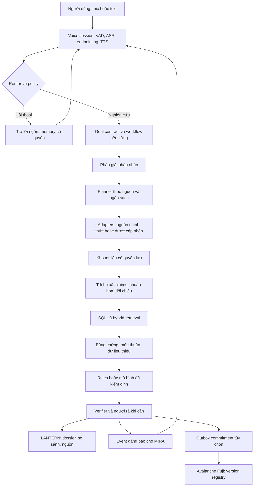

# MIRA + LANTERN VN: kiến trúc và workflow

**Thiết kế đề xuất ngày 01/11/2026, chưa triển khai.** Mục tiêu là một trợ lý có thể nói chuyện tự nhiên trong khi tiến trình thẩm định chạy bền vững, và một terminal cho phép kiểm tra lại từng kết luận. Đây là hợp đồng hành vi, không phải mô tả API đã tồn tại.

## 1. Kiến trúc tối thiểu

Quyết định: modular monolith có module riêng và worker tách khỏi HTTP/voice; PostgreSQL là nguồn trạng thái chính, object storage giữ tài liệu được phép, lexical + pgvector cho truy hồi. Quan hệ pháp nhân ban đầu là bảng cạnh trong Postgres. Chưa cần Neo4j, Kafka, một LLM cho mỗi vai trò hay graph embedding cho toàn quốc. Tách dịch vụ khi có tải, đội sở hữu hoặc lỗi độc lập thực sự cần.

Lựa chọn này giảm số thành phần phải vận hành trong ba tuần. Nó là đánh giá thiết kế theo quy mô dự kiến, chưa có load test. [pgvector](https://github.com/pgvector/pgvector) hỗ trợ vector search và kết hợp PostgreSQL full-text; tên riêng/MST vẫn đi qua exact/lexical filters, không giao cho vector tìm gần đúng một mình. Full-text mặc định không tự giải quyết tiếng Việt: thử chuẩn hóa dấu, alias, trigram và corpus thật; không gọi `ts_rank` là BM25.

## 2. Ba vòng đời tách biệt

**Voice session** quản lý mic, turn, transcript, playback và ngắt lời. **Goal workflow** quản lý nhiệm vụ, nguồn, chi phí, chờ và khôi phục. **Event loop** chọn khi nào cần nói/hiện card. “Dừng nói” dừng playback; “hủy điều tra” hủy workflow; “tạm dừng” lưu checkpoint. Người dùng hỏi chuyện thường trong lúc nghiên cứu không được làm mất mục tiêu.

MVP dùng cascade ASR → LLM → TTS, streaming khi có, push-to-talk là lựa chọn chắc chắn; bổ sung hands-free có endpointing và barge-in sau phép đo. [LiveKit turns](https://docs.livekit.io/agents/logic/turns/) phân biệt VAD, endpointing, turn detection và interruption. Dùng thư viện không đồng nghĩa đã đạt full-duplex tiếng Việt. Nếu dùng NORA Windows, tận dụng audio adapter hiện có; nếu web demo, thử một LiveKit session server, không đồng thời ghép thêm Pipecat chỉ vì có thể.

MIRA nhận ra casual chat, giải thích kiến thức và yêu cầu nghiên cứu; các câu như “ừ”, “tiếp đi” phải được hiểu theo trạng thái hiện tại. Critical slots gồm MST, tên pháp nhân, ngày chốt và phạm vi so sánh. ASR partial chỉ để hiện preview; khi không rõ “An Phát” nào phải hiện ứng viên/tỉnh/MST và hỏi một lần. Câu xã giao không tự mở goal, mua báo cáo, theo dõi liên tục hay chia sẻ hồ sơ.

Context xã giao và bằng chứng điều tra lưu riêng, có `tenant_id`, `session_id`, `goal_id`. Facts từ báo cáo không trở thành chỉ thị hệ thống. Memory lâu dài chỉ giữ sở thích người dùng đồng ý; một câu “công ty X lừa đảo” trong chat là claim cần kiểm tra, không phải dữ kiện.

## 3. Goal contract và các vai trò

| Trường contract | Nội dung cần có |
|---|---|
| Objective | Câu hỏi gốc, phần đã xác nhận và phần còn suy luận |
| Entities | Canonical entity ID, MST, alias, trạng thái khớp |
| Time | `as_of`, loại as-of, timezone, dữ liệu lịch sử có/không |
| Scope | Quốc gia, nguồn, loại rủi ro, tập so sánh và mục đích |
| Rights | Tenant, source entitlements, trường được lưu/hiện/gửi tới model |
| Budgets | Trần tool calls, tokens, tiền mua dữ liệu, thời gian, retries |
| Outputs | Dossier, evidence cards, missingness, kết quả chưa xác minh |
| Acceptance | Đúng pháp nhân/kỳ, citation kiểm được, phép tính đúng, không thiếu mục bắt buộc mà vẫn báo xong |

Một orchestrator có thể gọi các **vai trò logic**: entity resolver, retriever, extractor, legal-event parser, financial calculator, verifier và narrator. Chúng không mặc định là bảy agent tự do. Chỉ chạy song song các nhánh nguồn độc lập; hạn chế fan-out và hợp nhất bằng schema. Cùng một model có thể thực hiện nhiều vai trò; verifier độc lập nguồn và deterministic checks thường có giá trị hơn “nhiều agent cùng đồng ý”.

Theo ràng buộc của người dùng, ba agent nghiên cứu ở phiên này đều dùng `gpt-6.1-terra` / `xhigh`. Khi hiện thực hóa, không mặc định tên model trong Codex là một model ID API hợp lệ; cần kiểm tra endpoint thực tế và giữ cấu hình theo lựa chọn người dùng, không tự fallback sang model khác. ASR/TTS là mô hình âm thanh riêng, cũng cần quyền và benchmark.

Trạng thái: `queued → resolving → collecting → extracting → verifying → ready`; có nhánh `waiting_input`, `waiting_rights`, `budget_exhausted`, `partial`, `failed`, `cancelled`, `needs_reconciliation`. Lưu checkpoint sau từng bước đủ nhỏ. Worker chết giữa HTTP call cần đối soát receipt trước retry mua báo cáo hoặc ghi transaction. Không đồng nhất “request đã gửi” và “đã hoàn thành”.

[LangGraph persistence](https://docs.langchain.com/oss/python/langgraph/persistence) là ứng viên orchestration cho backend Python: checkpointer và store có vai trò khác nhau; in-memory checkpoint không bền sau restart. Thiết kế vẫn cần task idempotency và quyền. Không thêm cả LangGraph lẫn Temporal; xem xét Temporal sau nếu có nhiều connector trả phí, workflow kéo dài nhiều ngày và yêu cầu vận hành tương ứng. Nếu tái dùng Rust goal runtime, chọn một nơi sở hữu state, không tạo hai orchestrator điều khiển cùng goal.

## 4. Workflow một lệnh điều tra

Ví dụ **tổng hợp giả, không nói về doanh nghiệp thật**: “Mira, tìm An Phát ở Bình Dương, kiểm tra các hoạt động và dấu hiệu pháp lý có thể biết tới ngày 30/9/2026; so với hai đối tác này.”

1. Chốt scope và ngày. Tên không duy nhất thì hỏi MST hoặc cho chọn ứng viên. Nếu user muốn biết tại ngày 30/9, không dùng dữ kiện công bố tháng 10 để trả lời như đã biết tháng 9.
2. Lookup danh tính từ nguồn có quyền: MST, tên hiện tại/tên cũ, loại hình, địa chỉ công khai và trạng thái theo từng cơ quan. Check digit/format nếu có quy tắc được xác minh chỉ giúp kiểm cú pháp, không chứng minh MST tồn tại. Branch ID giữ quan hệ với công ty mẹ thay vì gộp.
3. Lập coverage checklist trước tìm: đăng ký, thuế, BCTC/công bố nếu có, thương mại/đấu thầu, pháp lý/thi hành án, sanctions có liên quan, tin và tài liệu khách hàng cấp quyền. Nguồn không truy cập được ghi đúng trạng thái; không tự thay thế bằng snippet không kiểm được.
4. Tìm exact ID trước, rồi alias, tên cũ, tên + địa phương và chủ đề. Một search engine giúp discovery; nguồn gốc quyết định claim. Mở trang/PDF, lưu bản có quyền và hash; giữ `published_at`, `fetched_at`, phiên bản, trang và quyền hiển thị.
5. Parse bảng/tài liệu bằng schema; giữ đơn vị VND/triệu/tỷ, kỳ, hợp nhất/riêng lẻ, kiểm toán/soát xét/tự lập, restatement. Dùng decimal/deterministic calculator cho ratios. OCR confidence thấp hoặc bảng lệch phải chuyển rà thủ công.
6. Mỗi claim ghép đúng entity, thời gian, trạng thái và nguồn. Tin bài trích lại cùng một quyết định chỉ là một sự kiện, không nhân mức nghiêm trọng vì có mười trang sao chép.
7. So sánh nguồn, giữ mâu thuẫn: ngày/hiệu lực khác nhau, thuế và đăng ký có định nghĩa khác nhau, một án sơ thẩm chưa là phán quyết cuối. Chưa phân giải được thì abstain ở kết luận liên quan.
8. Chạy rules theo version trên dữ liệu đã xác minh. Nếu thiếu tài chính, không sinh ratios; nếu chưa có mô hình hiệu chỉnh, không xuất PD. Candidate cần người xem nếu kết luận bất lợi trọng yếu hoặc entity match thấp.
9. Xuất dossier có phạm vi đã kiểm, nguồn không kiểm được, evidence cards, vector tín hiệu và điều kiện so sánh. Giọng nói 2–3 ý quan trọng và chỉ người dùng vào nguồn trên terminal.
10. Nếu được bật, ghi commitment báo cáo lên Fuji bằng outbox; chỉ hiện `anchored` khi có receipt và trạng thái xác nhận theo policy. Nghiên cứu vẫn dùng được khi chain tạm lỗi, với trạng thái `anchor_pending` rõ ràng.

## 5. Data contracts

| Record | Trường tối thiểu |
|---|---|
| Entity | `entity_id` nội bộ, loại pháp nhân/đơn vị phụ thuộc, MST, tên/alias, nguồn định danh, match status; version và khoảng valid/recorded của từng thuộc tính |
| Instrument | Mã nội bộ, ticker, sàn, ISIN/FIGI nếu có, issuer entity; mapping có `source_version_id`, `valid_from/to`, `recorded_from/to`, ngày công bố hoặc unknown |
| Source license | Chủ nguồn, terms URL/version, ingest/cache/AI/redisplay/export rights, expiry, tenant scope |
| Document version | URL, publisher, ngày công bố, ngày thu nhận, checksum, MIME, parser version, quyền giữ bản |
| Claim | Subject/predicate/object, giá trị/đơn vị/kỳ, đoạn/trang, `source_version_id`, status, extraction review, `valid_from/to`, `recorded_from/to`, ngày công bố hoặc unknown |
| Event | Loại sự kiện, ngày xảy ra/công bố/hiệu lực, thẩm quyền, trạng thái/kết cục, linked entities |
| Relationship | Hai entity, loại/hướng, `source_version_id`, `valid_from/to`, `recorded_from/to`, ngày công bố hoặc unknown; `reported`, `verified` hoặc `hypothesis` |
| Risk observation | Dimension, rules/model version, inputs snapshot, signal, missingness, reviewer |
| Report | Goal, query/cohort, as-of mode, source set, conclusions/limitations, version hash |
| Audit/outbox | Intent ID, operation, request fingerprint, receipt, retry/reconcile status |

Phiên bản claim/cạnh/mapping phải nối về phiên bản tài liệu cụ thể. Correction đóng khoảng recorded của bản cũ và thêm bản mới; chấm dứt quan hệ đóng valid interval. Giữ lịch sử theo kiểu append-only trong phạm vi được phép lưu, với quy trình xóa/hạn chế riêng theo nghĩa vụ; không ghi đè mất dấu sửa rồi vẫn hứa replay.

Không biến MST thành định danh của mọi cá nhân; không thu CCCD, địa chỉ riêng hay contact cá nhân không cần. Data rights phải đi cùng record/field qua retrieve, prompt, cache và export. Khi hết quyền nguồn, chặn truy hồi/hiển thị và xử lý bản lưu theo hợp đồng; không dùng một bản tóm tắt để xóa dấu vết nguồn có hạn chế.

## 6. As-of chính xác

Cần ít nhất `valid_from/valid_to`, `published_at`, `recorded_from/recorded_to`, `fetched_at`. Có ba chế độ khác nhau:

- **Publicly knowable at T:** chỉ dùng phiên bản công khai không muộn hơn T, có bằng chứng publication timestamp và khả năng khôi phục bản đó. Hiệu lực sự kiện có thể trước/sau ngày công bố; model phải diễn giải đúng.
- **Our system knew at T:** replay snapshot thực sự đã ghi tại T, không dùng bản mới ingest dù nội dung được công bố trước.
- **Retrospective state at T:** dùng thông tin hiện biết để dựng tình trạng có hiệu lực tại T; ghi rõ có hindsight, không dùng làm backtest thông tin sẵn có lúc T.

Ví dụ quyết định hiệu lực 01/03, công bố 10/03, ingest 12/03: không xuất hiện trong public-knowable ngày 05/03; có thể xuất hiện ngày 11/03 nếu giữ được bằng chứng phiên bản công khai; system-knew chỉ từ 12/03. Truy vấn thuần `valid_from <= T` gây leakage. Không biết ngày công bố thì báo không chứng minh được trạng thái historical; một website hiện tại không tự là archive.

Mỗi phép chấm phải giữ `model_version`, `trained_until`, feature snapshot và policy. Replay model hiện tại trên dữ liệu cũ khác với kết quả hệ thống thực sự đưa ra lúc đó. Đối với benchmark, cần thêm embargo theo độ trễ nhãn và kiểm soát entity/group overlap; không dùng model training tương lai để gọi là backtest nguyên trạng.

## 7. Risk screening trước, dự báo sau

V0 hiển thị các chiều: nhận diện/tình trạng, thuế, pháp lý, tài chính nếu có, vận hành/thương mại và liên quan. Tách **mức nghiêm trọng sự kiện**, **khả năng bằng chứng đúng** và **độ phủ**. Cả ba là trường riêng; một biến “confidence 90%” LLM tự sinh không thay thế chúng.

Sau ý kiến pháp lý, thử thứ tự ưu tiên rà soát trong cohort đủ dữ liệu. Quy tắc ban đầu có thể là decision table: sự kiện chính thức còn hiệu lực cần xử lý trước; bằng chứng mâu thuẫn đưa hàng chờ; nhóm đủ dữ liệu nhưng không phát hiện tín hiệu nằm cùng band, không ép thứ hạng 1–N. Thiếu dữ liệu → `unrankable`, không đưa về điểm 0. Trọng số và cutoffs nếu thử phải đăng ký trước, có sensitivity analysis và phản biện chuyên viên; chưa có trọng số nào được chứng minh ở repo này.

V1 cần nhãn, quyền dữ liệu và đánh giá pháp lý/điều kiện kinh doanh theo mục đích trước khi đưa ra ngoài hoặc sử dụng thực tế; có nhãn và hiệu chỉnh không tự đủ điều kiện. Nghiên cứu synthetic vẫn có thể thực hiện. Định nghĩa outcome/horizon/quần thể, baseline logistic hoặc gradient boosting, huấn luyện theo thời gian và hiệu chỉnh ngoài mẫu. Đưa graph features/GNN vào thử nghiệm sau khi edges có quyền và chứng cứ, so ngang với baseline cùng feature date. Legal-risk event, default và stock return là các target khác nhau. Không ghép thành xác suất “an toàn đầu tư” duy nhất.

## 8. Avalanche: một phần có thể kiểm chứng

Đề xuất **ReportVersionRegistry** trên Fuji C-Chain, [mạng EVM testnet chain ID 43113](https://build.avax.network/docs/primary-network). Chưa có contract/address trong repo. Bản demo tương lai cần thao tác thật: publish commitment, đọc receipt, tải báo cáo và verify, sửa một byte rồi verify thất bại, tạo bản đính chính và liên kết supersession.

Off-chain: dữ liệu có quyền, bản báo cáo, salts ngẫu nhiên đủ entropy và access policy. On-chain: root commitment theo batch, schema/version công khai, thời điểm/tx metadata và issuer pseudonymous; không MST, tên DN, score, audio, transcript, URL bí mật hay leaf dễ dò. Canonical serialization và domain separation phải được chốt, có test vectors; hash leaf gồm random nonce, không hash trần MST hay báo cáo dễ đoán. Khi chia sẻ proof, đánh giá khả năng người nhận liên kết dữ liệu; pseudonym không tự làm mất tính cá nhân.

Batch commitments tiết kiệm giao dịch, nhưng chỉ chứng minh dữ liệu đưa vào có commitment đã tồn tại không muộn hơn block được ghi, trong giả định chain/finality; không chứng minh ngày dữ liệu gốc phát sinh, đầy đủ, hợp pháp hay đúng. Demo dùng tài liệu tổng hợp hoặc đã được phép, không công khai kết luận bất lợi về doanh nghiệp thật lên chuỗi. Thu hồi/supersede thay hiển thị bản mới; root cũ không xóa được, nên phải rà khả năng xóa và tái liên kết trước pilot.

Issuer cần định danh/địa chỉ hoặc public key được xác thực theo policy, chữ ký và quyền ghi; liên kết supersession chỉ hợp lệ khi được issuer/chủ thể có thẩm quyền ký. Contract kiểm quyền gọi, chain ID, replay và version; viewer kiểm issuer, proof, receipt và finality trước khi gọi một bản là bản chính thức. Root hash đơn độc không xác thực danh tính tổ chức hay quyền đính chính; địa chỉ relayer không tự đại diện cho tác giả báo cáo. Metadata xác thực cũng phải qua đánh giá privacy.

Agent không giữ seed phrase hoặc tự có quyền giao dịch ngoài chức năng registry. Ví người dùng ký hoặc relayer có key/scopes/quota riêng, allowlist chain/contract/function, idempotency theo report version. Không cần token, L1 riêng, x402 hay thanh toán thật cho MVP; tích hợp không được dùng làm cách lách quy định off-chain. Giá trị sản phẩm của anchoring cần so với signed audit log thông thường, và kiểm với mentor vì tiêu chí Avalanche chiếm 25 điểm.

## 9. Bảo mật và vận hành

Policy chạy trước retrieval, trước gửi LLM và trước export/chain action. Tool descriptions và danh mục connector được khóa/version; tài liệu không được thêm tool, đổi goal hay yêu cầu gửi secrets. Validate schema, giới hạn số trang/kích thước, network destinations allowlist, tách sandbox parser khỏi secrets. Web snippets/OCR đều là dữ liệu không tin cậy.

Mọi call có deadline, retry/backoff có trần, nguồn bị rate-limit có circuit breaker; budget reservation trước fan-out. Dùng stable job IDs, unique constraints, outbox và receipt reconciliation. Một HTTP timeout không đủ kết luận chưa mua report/chưa gửi tx. Checkpoint chỉ giữ dữ liệu tối thiểu có quyền; encrypt và retention áp dụng cả traces, caches và embeddings. Tách tenant và row access, không ghi raw audio/token/key vào logs.

Quan sát theo `goal_id`/`source_id`: source age, retrieval failures, extraction conflicts, citation support, cost, queue wait, ASR/LLM/TTS latency, stop-speech latency và anchoring backlog. Người dùng chỉ nhận câu hỏi cần quyết định, phát hiện đáng chú ý, failure hay kết quả; không nghe log kỹ thuật, hidden reasoning hoặc heartbeat lặp lại.

